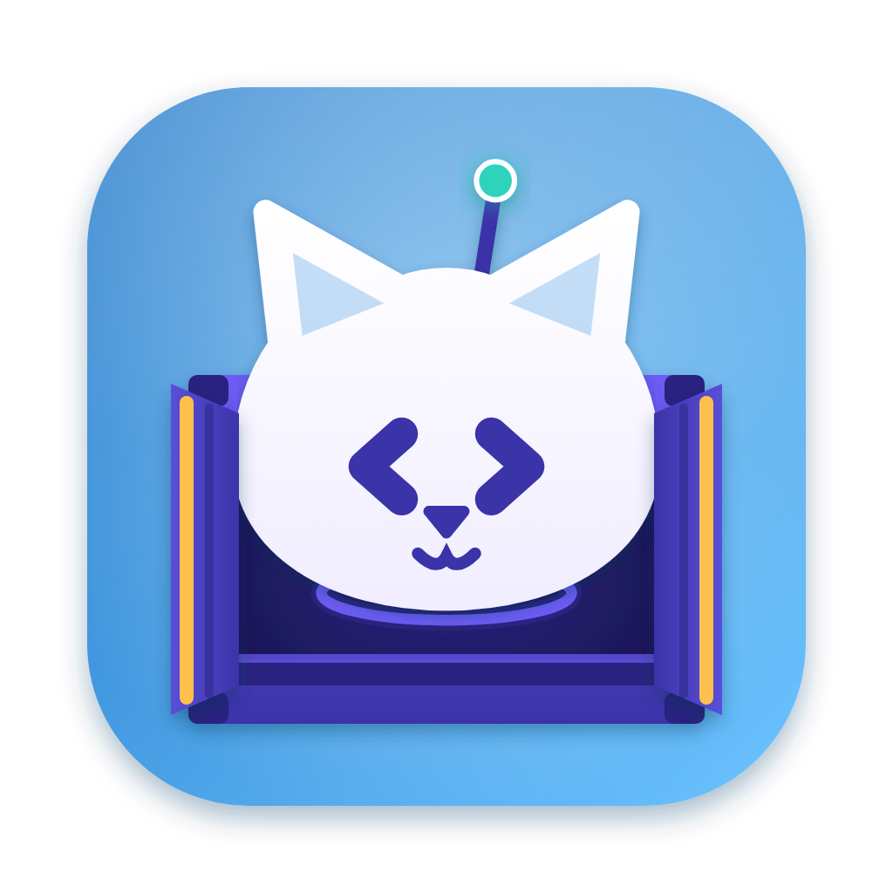

<p align="center"></p>

<h1 align="center">DoCatz</h1>
<p align="center"><em>If it fits, it ships.</em></p>
<p align="center">
  <a href="https://catzoid.com/docatz">Website</a> ·
  <a href="https://catzoid.com/docatz/download">Download</a> ·
  <a href="https://catzoid.com/docs">Docs</a> ·
  <a href="https://catzoid.com/community">Community</a>
</p>

A fast, light Docker engine and container manager for macOS and Windows: a small Linux VM (WSL 2 on Windows) runs Docker, your
containers are grouped by compose project with their logs, a terminal and their files, and every container gets its
own domain without publishing a port — `https://web.shop.docatz.localhost`.

Part of [Catzoid](https://catzoid.com) — free, open-source developer tools with nine lives. All cats, no catch: no
account, no Pro tier, nothing locked behind a payment.

> **Early days.** DoCatz is in its first builds and not released yet; it ships with the next DevCatz update.

## What it does

- **The engine** — a Linux VM on Apple's Virtualization framework (through [Lima](https://lima-vm.io)) with fast
  file sharing for your home folder and Rosetta for Intel images; WSL 2 on Windows. CPUs, memory and disk are yours to
  set. Everything it downloads is pinned to a known checksum and kept in `~/.docatz`.
- **Your docker keeps working** — DoCatz brings docker, compose and buildx and adds a `docatz` context; nothing
  switches until you choose *Use DoCatz as the default*, so Docker Desktop or OrbStack can stay side by side.
- **Containers** — grouped by compose project; start, stop, restart, remove; live logs with search, a terminal
  inside, a file browser, CPU and memory. Compose files open, edit and run (Up, Down, Pull, Build) with their output.
- **Images, volumes, networks** — sizes, who uses what, and clean-up that lists exactly what goes first.
- **Domains** — the default domain, HTTPS certificate and URLs without a port are shared with
  [DevCatz](https://github.com/catzoidhub/DevCatz), and work with DoCatz alone too.
- **AI, optional** — Ask DoCatz in plain words, Explain with AI on a failing container's logs, write or fix a compose
  file. Off until you turn it on; container names and states go out, never environment values or secrets.

## Install

Download the DMG from [catzoid.com/docatz/download](https://catzoid.com/docatz/download) — it picks the right
build for your Mac (Apple silicon or Intel, macOS 13 or later). Or with Homebrew — it asks you to trust a tap
that is not its own the first time:

```bash
brew tap catzoidhub/catz && brew trust catzoidhub/catz
brew install --cask docatz
```

The app is signed and notarized by Apple and updates itself (Settings → About → Check for Updates).

Windows 10 / 11 (x64): `DoCatz-Setup-<version>.exe` from the same page or the
[latest release](https://github.com/catzoidhub/DoCatz/releases/latest). It installs for your account only, no
administrator rights needed. It is not code-signed yet (see Code signing below).

## Build from source

```bash
bun install
bun run dev          # run it in development
bun run typecheck
bun run package      # a signed DMG in dist/ (notarized when a notarytool profile is set up)
```

Found a bug? Use **Help → Report a Bug…** in the app, or [open an issue](https://github.com/catzoidhub/DoCatz/issues).

## Code signing

macOS builds are signed with a Developer ID and notarized by Apple. **The Windows installer is not code-signed yet**:
the SignPath Foundation, which signs open-source projects for free, asks for a project with more history and public
use than DoCatz has today, and paid certificates are out of reach for now. Windows SmartScreen therefore warns when you
open the installer: choose **More info → Run anyway**. The installer is built by GitHub Actions from this repository,
so what you run is this source. Stars, issues and pull requests help DoCatz qualify for free signing later. Policy:
[catzoid.com/legal/code-signing](https://catzoid.com/legal/code-signing).

## How it is made

DoCatz is made by a small team of three developers, and its code is written together with
[Claude by Anthropic](https://www.anthropic.com/claude), an AI assistant. The team decides what the cat does, designs
it, tries every feature on a real computer and reviews every change before it ships — Claude writes and explains the
code with them. Every commit Claude helped with says so (`Co-Authored-By: Claude`), so you can read, test or question
any of it. Found something that looks wrong? Open an issue — a person reads every report.

Catzoid is an independent project; it is not made, sponsored or endorsed by Anthropic.

## Licence

DoCatz is free software: you can redistribute it and/or modify it under the terms of the GNU General Public License
as published by the Free Software Foundation, version 3. It comes with no warranty. See [`LICENSE`](LICENSE).

The names Catzoid and DoCatz and the Catzoid cat are trademarks and are **not** covered by the licence: a fork must
use its own name and icon. See [`TRADEMARKS.md`](TRADEMARKS.md).

Contributions are welcome — see [`CONTRIBUTING.md`](CONTRIBUTING.md). Before your first pull request is merged you
sign the [contributor licence agreement](CLA.md) through the CLA check on the pull request — you keep the copyright of
your work. Questions and bug reports: [`SUPPORT.md`](SUPPORT.md); security problems, privately: [`SECURITY.md`](SECURITY.md).

Copyright © 2026 Mahryan Rakhmatullah
